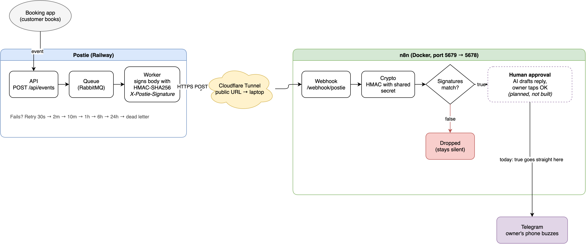

# How I use AI agents as an engineer

Postie is a webhook delivery service I built with an AI coding agent. This is how I keep the agent useful without letting it decide for me: the setup, the process, the evidence, where it went wrong, and where I don't let it go.

## 1. The harness

Each piece is there to stop one specific thing going wrong.

| Piece | What it prevents |
|---|---|
| `CLAUDE.md` | Claude guessing. Without it, Claude rewrote a helper that already existed (`findOwnedApplication`) because nothing told it the helper was there |
| `/plan-feature` | Code that's wrong from the first line. The agent writes a design doc first, no code |
| `/why` | Me shipping code I can't explain. The agent questions me on the design, the way my coach does |
| Skills (`postie-endpoint`, `react-page`) | Every endpoint or page coming out a different way. Like a head chef's recipe, so every dish tastes the same |
| `code-reviewer` subagent | Bugs the coding agent missed reaching `main`. It caught the endpoint signing secret being returned on every list/get, not just once (#51) |
| Hook: `block-secrets.sh` | Claude running commands that print secrets from `.env` |
| Hook: lint after every edit | Syntax and style mistakes slipping past, caught the moment a file changes |
| Permissions | Claude running things that can't be undone: `git push`, `rm -rf`, resetting the database. Those go through me |
| MCP (Postgres, local only) | Never pointed at production: an agent with live database access risks taking the system down, losing data, or leaking sensitive data |

## 2. The flow

Every feature goes through the same seven steps:

1. `/plan-feature`: the agent writes a design doc, no code
2. I edit the doc. The decisions are mine
3. The agent implements the doc
4. `/why`: the agent questions me on the design
5. I read every line of the diff. Anything I can't explain gets deleted
6. Automated tests, then I use the real thing by hand
7. A PR with What / Why / How / Testing, and which files were agent-assisted

These sit inside three gates: **design** (a plan exists before code), **review** (I read every changed line), **explain** (I can defend it with no notes).

Steps 4 and 5 matter most to me: they stop me shipping code I don't understand. The one I used to skip was step 6, because I didn't know what "testing by hand" meant. Now I do: use the real product like a user. On 18 Nov, that's how I found a dashboard bug no test caught. The Events page said "pending" while my phone had already buzzed, because the table only showed the first of six deliveries (fixed in #66, #67).

## 3. Evidence

- **Output:** 41 merged PRs. CI runs the test suite on every push.
- **Time per feature:** I aim for one small PR per hour. Git backs it up: on 8 Nov, PRs #58–#64 opened 34–80 minutes apart. Earlier (Weeks 3–8) I worked in big batches, like 7 PRs opened within 10 minutes on 2 Aug, or #55, a single PR with the circuit breaker, dashboard and CI together.
- **Review share:** about 15–20 minutes of each hour goes to reading the diff and `/why`, so roughly a quarter to a third. *(My estimate, not timed.)*
- **What review caught:** the code-reviewer agent flagged that endpoint secrets were returned on list/get/patch (fixed in #51). It also flagged an API key used in the browser ([failure log](AI_WORKFLOW.md), Entry 4).
- **What a hook didn't catch:** when I tested my own `block-secrets` hook, I found ways around it (Entry 9). The hook guards against slips. It is not a wall.

## 4. Three times the AI got it seriously wrong

**1. It leaked the webhook signing secret.** The agent's endpoint API (#49) returned each endpoint's HMAC secret on every GET and PATCH, not just once at creation. Anyone who could list endpoints could forge signed webhooks to my users. My code-reviewer subagent caught it, but only after merge; it was fixed five days later in #51. Secrets are now shown once, and tests assert `secret` is absent from every read and update response.

**2. It knew the rule and broke it anyway, three times.** `CLAUDE.md` said ownership checks go through `findOwnedApplication`. The agent wrote its own check instead. I reworded the rule twice, and it still did it. On the third run, it named the correct function in a comment and still didn't call it. Lesson: a written rule is not a guarantee. Reading the diff is, especially for authorization code.

**3. It nearly put the company-wide API key in the browser.** My `react-page` skill pointed the dashboard at a route protected by the shared API key, and `CLAUDE.md` wrongly said that route used a login. Anyone opening dev tools could have taken the key. The code-reviewer flagged it. I built separate `/api/dashboard/*` routes behind user login, and I now check the real code instead of trusting my own docs.

Full details: [AI_WORKFLOW.md](AI_WORKFLOW.md), Entries 1–4 and 9.

## 5. The business layer

Postie's events can drive real workflows for non-technical owners. A working example: Postie → n8n (self-hosted in Docker) → signature check → Telegram. When a booking event arrives with a valid signature, the owner's phone buzzes. A fake or tampered event is dropped silently.

**Why it matters to a business:** a spa owner who checks messages by hand will miss bookings, and each missed booking is lost revenue. The workflow costs about $15/month to run *(estimate)*. A worked cost example is in [AI_FOR_BUSINESS.md](AI_FOR_BUSINESS.md).

**Next step, not built yet:** a human-approval step. The AI drafts the reply to the customer, the owner taps "approve" in Telegram, and only then is it sent. The AI drafts and the human decides, because a wrong time or price sent to a real customer costs trust.

## 6. Limits

**Instructions are not locks.** My agent once broke a written rule three times while naming the correct function in a comment (failure 2). So anything that must never happen is enforced by the system, not requested in `CLAUDE.md`:

- **Database access (MCP) runs on my local database only.** Never production. If it ever needed real data, it would get a read-only account.
- **Permissions deny** `git push`, `rm -rf`, `reset --hard`, and reading `.env`. The agent can't run them, whatever it decides.
- **No feature runs on AI judgment alone.** The AI drafts and a human approves.

Locks can have holes too (my secret hook did), so I test them by trying to break them.

**Rule of thumb:** AI for messy work (drafting, summarising), code for exact work (signatures, money, permissions).

## 7. Diagram

Postie signs each event with HMAC-SHA256 and retries failures on a ladder (30s → 24h → dead letter). n8n recomputes the signature with the shared secret: a match goes on to Telegram, a mismatch is dropped. The dashed box is the planned human-approval step. Source: [`postie-n8n-flow.drawio`](postie-n8n-flow.drawio).
